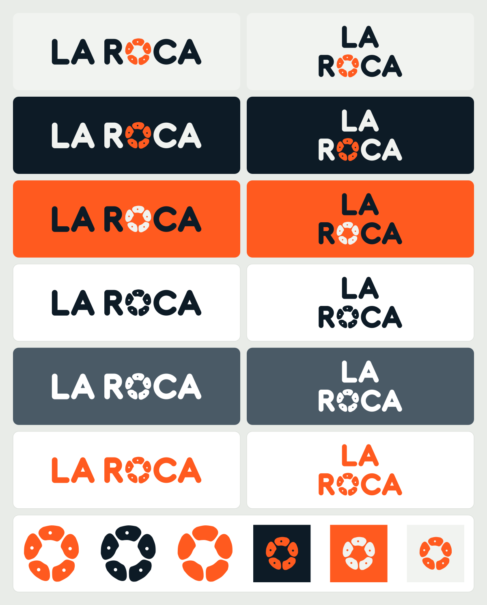
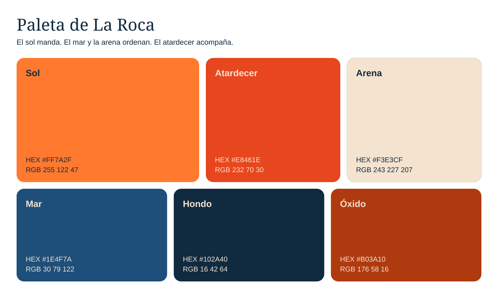
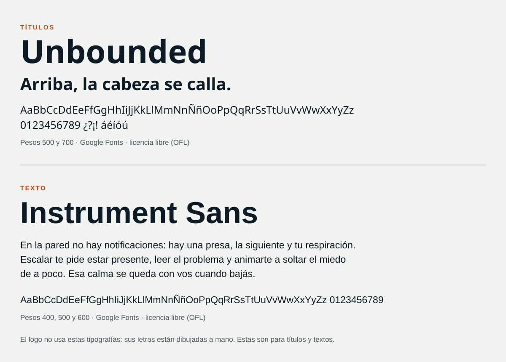

# Marca de La Roca

Guía corta para usar el logo, los colores y las tipografías de La Roca, el muro de escalada del Complejo Trebi en Mar del Plata.



## La idea

La O de ROCA es una **ronda de cinco presas**, cada una con su forma y su agujero de bulón. Nadie es igual y todas entran en el mismo círculo: eso es La Roca, un lugar para encontrarte con tu gente, despejar la cabeza y ganar fuerza sin contar repeticiones.

Las letras no salen de ninguna tipografía: están dibujadas para La Roca, con trazo grueso y puntas redondas, para que el logo se sienta cercano y propio.

## Qué archivo usar

| Necesito… | Archivo |
| --- | --- |
| El logo en general (web, documentos, fondos claros) | `logo/la-roca-horizontal.svg` |
| El logo sobre fondo oscuro | `logo/la-roca-horizontal-fondo-oscuro.svg` |
| El logo sobre fondo naranja | `logo/la-roca-horizontal-fondo-naranja.svg` |
| Un espacio más cuadrado (posteos, carteles, remeras) | `logo/la-roca-vertical*.svg` (mismas variantes) |
| Imprimir en un solo color (sellos, grabado, vinilo) | `logo/*-una-tinta-noche.svg`, `*-una-tinta-blanco.svg` o `*-una-tinta-naranja.svg` |
| Solo el símbolo | `isotipo/ronda.svg` (también en `-noche` y `-blanco`) |
| El símbolo muy chico (menos de 32 px) | `isotipo/ronda-simple.svg` (sin agujeros) |
| Foto de perfil de Instagram, WhatsApp, Google | `icono/icono-noche.svg` o `icono/icono-naranja.svg` |
| Ícono de la pestaña del navegador | `icono/favicon.svg` |
| Colores para la web | `colores.css` (variables `--roca-*`) o `colores.json` |

## Logo

- **Horizontal** es la versión principal. **Vertical** (LA arriba, ROCA abajo) es para formatos cuadrados o angostos.
- **Color sobre claro:** letras en Noche, ronda en Naranja. **Sobre oscuro:** letras en Magnesio, ronda en Naranja. **Sobre naranja:** letras en Noche, ronda en Magnesio.
- **Sobre fotos o videos** usá la versión de una tinta en blanco, sobre una zona tranquila de la imagen o con un velo oscuro.
- **Espacio libre:** alrededor del logo dejá al menos la mitad de la altura de las letras. Si las letras miden 40 px, 20 px libres de cada lado.
- **Tamaño mínimo:** horizontal, 100 px de ancho en pantalla o 30 mm impreso. Vertical, 60 px o 18 mm. Debajo de eso, usá el isotipo.

**No hagas esto:**

- Estirar, aplastar, inclinar o rotar el logo o la ronda.
- Reescribir "La Roca" con una tipografía en lugar de usar el archivo.
- Pintar las presas de colores distintos entre sí o usar colores fuera de la paleta.
- Poner la versión a color sobre una foto con mucho detalle.
- Agregarle sombras, contornos o efectos.

## Colores



| Color | HEX | Para qué |
| --- | --- | --- |
| Naranja Ronda | `#FF5A1F` | El color de la marca. La ronda, fondos de impacto, botones. |
| Naranja tostado | `#C4400F` | Naranja para texto chico y enlaces sobre fondos claros. |
| Noche atlántica | `#0D1B26` | Letras del logo, texto y fondos oscuros. |
| Magnesio | `#F1F3F0` | Fondo claro principal. |
| Durazno | `#FFB089` | Acento suave, fondos de tarjetas. |
| Lila | `#B49CFF` | Acento secundario. |
| Menta | `#8EE0C3` | Acento secundario. |

El naranja manda; Noche y Magnesio ordenan. Durazno, Lila y Menta son los colores de las presas: acentos, no protagonistas.

**Para que se lea bien:**

- Texto sobre naranja: siempre en **Noche** (contraste 5,6:1). El blanco o el magnesio sobre naranja solo sirven para títulos muy grandes.
- Naranja sobre fondo claro: para texto chico o enlaces usá **Naranja tostado** (4,6:1 sobre Magnesio). El Naranja Ronda queda para formas, botones grandes y la ronda.
- Naranja sobre Noche funciona para texto (5,6:1).
- Texto en Noche sobre Durazno, Lila o Menta se lee bien (más de 7:1).

## Tipografías



- **Títulos: [Unbounded](https://fonts.google.com/specimen/Unbounded)**, pesos 500 y 700.
- **Texto: [Instrument Sans](https://fonts.google.com/specimen/Instrument+Sans)**, pesos 400 a 600.

Las dos son gratuitas (Google Fonts, licencia OFL) y son las mismas que usa la web. Para cargarlas en una página:

```html
<link rel="stylesheet" href="https://fonts.googleapis.com/css2?family=Instrument+Sans:wght@400;500;600&family=Unbounded:wght@500;700&display=swap">
```

`tipografia.svg` y `paleta.svg` cargan las fuentes desde Google Fonts: abiertas en el navegador se ven con las tipografías reales; en otros programas puede aparecer una tipografía de reemplazo. Los archivos del logo no dependen de ninguna fuente.

## Cómo suena La Roca

- Cercana y en voseo: "vení", "animate", "tu gente".
- Habla de lo que la escalada te da por dentro (calma, confianza, comunidad) antes que del rendimiento.
- Invita, no exige: siempre está permitido caerse.

## Cambiar o regenerar los archivos

Todo sale de `fuente/generar.mjs` (letras, ronda, variantes, colores y estas hojas). Para regenerar:

```bash
node brand/fuente/generar.mjs
```
